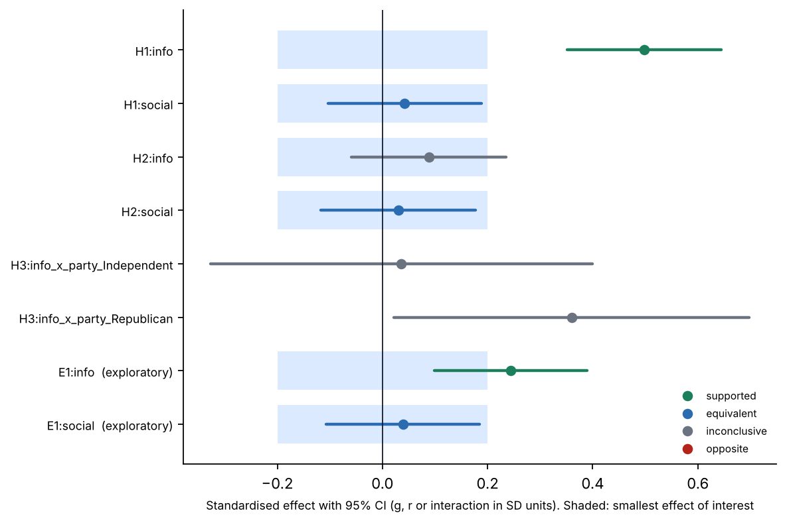
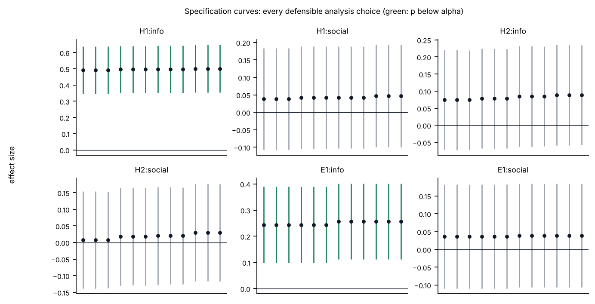

# Does an informational message raise trust? (synthetic demo)

**Provenance:** automated analysis with ScienceUnbound 0.1.0; no human review recorded. **Plan:** Plan locked 2026-10-16T21:58:39Z (self-asserted time; not yet committed to GitHub), on or before the declared end of data collection (2026-10-16). 

<!-- su:verification:start -->
**Numbers verified: PASSED.** 248 numbers in the text were checked against the result tables by an independent script; 0 did not match. 8 of 8 estimates are reported; 0 table or result-line entries disagree with their source row.
<!-- su:verification:end -->

Authors: <!-- su:author -->ScienceUnbound demo<!-- su:/author -->

## Summary

This randomized experiment analyses 1,077 respondents after exclusions. Of 6 confirmatory estimates, 1 was supported, 2 were equivalent to zero within the smallest effect of interest, 3 were inconclusive. H1:info (<!-- su:author -->Information raises trust<!-- su:/author -->): g = 0.50 [0.35, 0.64].

<!-- su:author -->Synthetic data with planted effects, used to demonstrate the pipeline. Nothing here is an empirical finding.<!-- su:/author -->

## Design and sample

| Step | Removed | Remaining |
|---|---|---|
| Rows in the file | 0 | 1200 |
| Did not finish the survey | 35 | 1165 |
| Failed the attention check | 88 | 1077 |

| Arm | N |
|---|---|
| <!-- su:author -->Control<!-- su:/author --> | 378 |
| <!-- su:author -->Information<!-- su:/author --> | 350 |
| <!-- su:author -->Social norm<!-- su:/author --> | 349 |

- Outcome `trust_index`: index of 4 item(s), valid N = 1077, Cronbach's alpha = 0.82.
- Outcome `donation`: single of 1 item(s), valid N = 1077.
- Outcome `policy_item`: single of 1 item(s), valid N = 1077.

## Plan and registration status

Plan locked 2026-10-16T21:58:39Z (self-asserted time; not yet committed to GitHub), on or before the declared end of data collection (2026-10-16).

| Hypothesis | Status | Differences from the locked plan | Reason given |
|---|---|---|---|
| H1 | registered | none |  |
| H2 | registered | none |  |
| H3 | registered | none |  |
| E1 | exploratory | none |  |

## Confirmatory results

| Analysis | Contrast | N | Estimate | Effect size [95% CI] | Test | p | p (adj.) | Verdict | Status |
|---|---|---|---|---|---|---|---|---|---|
| H1:info | <!-- su:author -->Information vs Control<!-- su:/author --> | 723 | 0.45 | 0.50 [0.35, 0.64] | one-sided (+) | < .001 | < .001 | supported | registered |
| H1:social | <!-- su:author -->Social norm vs Control<!-- su:/author --> | 722 | 0.04 | 0.04 [−0.10, 0.19] | one-sided (+) | .285 | .856 | equivalent to zero | registered |
| H2:info | <!-- su:author -->Information vs Control<!-- su:/author --> | 723 | 1.46 | 0.09 [−0.06, 0.24] | one-sided (+) | .119 | .477 | inconclusive | registered |
| H2:social | <!-- su:author -->Social norm vs Control<!-- su:/author --> | 722 | 0.51 | 0.03 [−0.12, 0.18] | one-sided (+) | .343 | .856 | equivalent to zero | registered |
| H3:info_x_party_Independent | <!-- su:author -->Information vs Control, difference by party: Independent vs Democrat<!-- su:/author --> | 723 | 0.04 | 0.04 [−0.33, 0.40] | two-sided | .846 | .856 | inconclusive | registered |
| H3:info_x_party_Republican | <!-- su:author -->Information vs Control, difference by party: Republican vs Democrat<!-- su:/author --> | 723 | 0.43 | 0.36 [0.02, 0.70] | two-sided | .037 | .185 | inconclusive | registered |

- **H1:info** — <!-- su:author -->Information vs Control<!-- su:/author --> on <!-- su:author -->trust_index<!-- su:/author -->: g = 0.50 [0.35, 0.64], p < .001 (one-sided), adjusted p < .001, N = 723. Verdict: supported.
- **H1:social** — <!-- su:author -->Social norm vs Control<!-- su:/author --> on <!-- su:author -->trust_index<!-- su:/author -->: g = 0.04 [−0.10, 0.19], p = .285 (one-sided), adjusted p = .856, N = 722. Verdict: equivalent to zero. Equivalence to zero within ±0.20 SD was shown by two one-sided tests (p = .017; these use a 90% interval).
- **H2:info** — <!-- su:author -->Information vs Control<!-- su:/author --> on <!-- su:author -->donation<!-- su:/author -->: g = 0.09 [−0.06, 0.24], p = .119 (one-sided), adjusted p = .477, N = 723. Verdict: inconclusive. The design could detect effects of 0.21 or larger with 80% power; equivalence within ±0.20 SD was not shown (equivalence test p = .068).
- **H2:social** — <!-- su:author -->Social norm vs Control<!-- su:/author --> on <!-- su:author -->donation<!-- su:/author -->: g = 0.03 [−0.12, 0.18], p = .343 (one-sided), adjusted p = .856, N = 722. Verdict: equivalent to zero. Equivalence to zero within ±0.20 SD was shown by two one-sided tests (p = .012; these use a 90% interval).
- **H3:info_x_party_Independent** — <!-- su:author -->Information vs Control, difference by party: Independent vs Democrat<!-- su:/author --> on <!-- su:author -->policy_item<!-- su:/author -->: g (interaction) = 0.04 [−0.33, 0.40], p = .846 (two-sided), adjusted p = .856, N = 723. Verdict: inconclusive. The design could detect effects of 0.52 or larger with 80% power.
- **H3:info_x_party_Republican** — <!-- su:author -->Information vs Control, difference by party: Republican vs Democrat<!-- su:/author --> on <!-- su:author -->policy_item<!-- su:/author -->: g (interaction) = 0.36 [0.02, 0.70], p = .037 (two-sided), adjusted p = .185, N = 723. Verdict: inconclusive. The design could detect effects of 0.48 or larger with 80% power.

## Exploratory results (EXPLORATORY — not pre-registered)

| Analysis | Contrast | N | Estimate | Effect size [95% CI] | Test | p | p (adj.) | Verdict | Status |
|---|---|---|---|---|---|---|---|---|---|
| E1:info | <!-- su:author -->Information vs Control<!-- su:/author --> | 728 | 0.29 | 0.24 [0.10, 0.39] | two-sided | .001 | .002 | supported | exploratory |
| E1:social | <!-- su:author -->Social norm vs Control<!-- su:/author --> | 727 | 0.05 | 0.04 [−0.11, 0.18] | two-sided | .598 | .598 | equivalent to zero | exploratory |

- **E1:info** — <!-- su:author -->Information vs Control<!-- su:/author --> on <!-- su:author -->policy_item<!-- su:/author -->: g = 0.24 [0.10, 0.39], p = .001 (two-sided), adjusted p = .002, N = 728. Verdict: supported.
- **E1:social** — <!-- su:author -->Social norm vs Control<!-- su:/author --> on <!-- su:author -->policy_item<!-- su:/author -->: g = 0.04 [−0.11, 0.18], p = .598 (two-sided), adjusted p = .598, N = 727. Verdict: equivalent to zero. Equivalence to zero within ±0.20 SD was shown by two one-sided tests (p = .015; these use a 90% interval).

## Robustness: specification curves

Each estimate was recomputed under every combination of covariate set, error type and outlier handling listed in the specification table. The table shows how many variants agree with the main estimate.

| Analysis | Variants | Same sign | p below alpha | Smallest effect size | Median | Largest |
|---|---|---|---|---|---|---|
| E1:info | 12 | 1.00 | 1.00 | 0.24 | 0.25 | 0.26 |
| E1:social | 12 | 1.00 | 0.00 | 0.04 | 0.04 | 0.04 |
| H1:info | 12 | 1.00 | 1.00 | 0.49 | 0.50 | 0.50 |
| H1:social | 12 | 1.00 | 0.00 | 0.04 | 0.04 | 0.05 |
| H2:info | 12 | 1.00 | 0.00 | 0.07 | 0.08 | 0.09 |
| H2:social | 12 | 1.00 | 0.00 | 0.01 | 0.02 | 0.03 |

## Design checks

- Sample-ratio check: chi-square = 1.51, p = .470.
- Baseline balance: 0 of 2 covariate comparisons have p below .05 (about 5% are expected by chance).
- No outcome values are missing in any arm.

## What a follow-up would need

Sample sizes for 80% power at the plan's alpha (two groups, equal allocation, normal approximation; for correlations, total N). A first study that happened to be significant overstates the true effect on average, so smaller effects are shown too. Effects that would need an impractically large sample are omitted.

| Analysis | Effect assumed | Value | N per group | N total |
|---|---|---|---|---|
| H1:info | observed | 0.50 | 64 | 128 |
| H1:info | half of observed | 0.25 | 254 | 508 |
| H1:info | nearest confidence bound | 0.35 | 128 | 256 |
| H1:info | smallest effect of interest | 0.20 | 393 | 786 |
| H1:social | observed | 0.04 | 8804 | 17608 |
| H1:social | smallest effect of interest | 0.20 | 393 | 786 |
| H2:info | observed | 0.09 | 2014 | 4028 |
| H2:info | half of observed | 0.04 | 8053 | 16106 |
| H2:info | smallest effect of interest | 0.20 | 393 | 786 |
| H2:social | observed | 0.03 | 17162 | 34324 |
| H2:social | smallest effect of interest | 0.20 | 393 | 786 |
| E1:info | observed | 0.24 | 264 | 528 |
| E1:info | half of observed | 0.12 | 1056 | 2112 |
| E1:info | nearest confidence bound | 0.10 | 1628 | 3256 |
| E1:info | smallest effect of interest | 0.20 | 393 | 786 |
| E1:social | observed | 0.04 | 10263 | 20526 |
| E1:social | smallest effect of interest | 0.20 | 393 | 786 |

## Limitations

- Treatment was randomised according to the plan; the sample-ratio and balance checks below test that assumption, not prove it.
- Outcomes are analysed with linear models (heteroskedasticity-robust errors unless stated). Binary outcomes are linear probability models.
- Rows with a missing outcome or covariate are dropped listwise; the table shows how many were dropped per estimate.
- Multiplicity: Holm adjustment is applied within the confirmatory family; exploratory estimates form their own family with Benjamini-Hochberg adjustment.
- 3 confirmatory estimates are inconclusive: the study could not rule effects of the sizes shown in 'could detect' out, and absence of significance is not evidence of absence.
- No survey weights were used; estimates describe the sample, not a weighted population.
- This report was produced by an automated pipeline. No human review is recorded unless the provenance line says so.

## Privacy and data

Before analysis, 7 column(s) were removed after a scan of every cell: `ResponseId`, `IPAddress`, `StartDate`, `zip`, `RecipientEmail`, `open_comment`, `participant_code`.
Re-identification check on `age`, `gender`, `party`: every combination is shared by at least 5 respondents (target 5).
- Generalised: age: grouped into 2 bands
- Generalised: 8 respondents in rare combinations: quasi-identifier values suppressed (set to missing)

Respondent-level data are included in this package (`data/analysis_input.csv`).

## Provenance and reproducibility

- Generated 2026-10-16 by ScienceUnbound 0.1.0.
- Plan SHA-256 `11826310a9f5ab467dd40bcdee7f18dabd2a23bb7b64d5b52baf64d4347005fb`; random seed 20260101.
- Environment: matplotlib 3.11.2, numpy 2.5.3, pandas 3.0.5, python 3.13.16, scienceunbound 0.1.0, scipy 1.18.1, statsmodels 0.15.0.
- `scripts/reproduce.py` re-runs the analysis and compares every number with `results/effects.csv`.

## How to cite

<!-- su:author -->ScienceUnbound demo. Does an informational message raise trust? (synthetic demo).<!-- su:/author --> ScienceUnbound study report, 2026-10-16. https://github.com/eugendimant/ScienceUnbound

Content licence: CC BY 4.0.

## Credits

The idea of an agent-friendly platform that turns unpublished projects into checked, citable research reports originates with Yamil Ricardo Velez (Filedrawer.org, https://github.com/yrvelez/filedrawer), who built the first version after Robb Willer raised automated public research reports as a response to publication bias.

ScienceUnbound is an independent re-implementation. It contains no code from Filedrawer and is not affiliated with or endorsed by its author.
